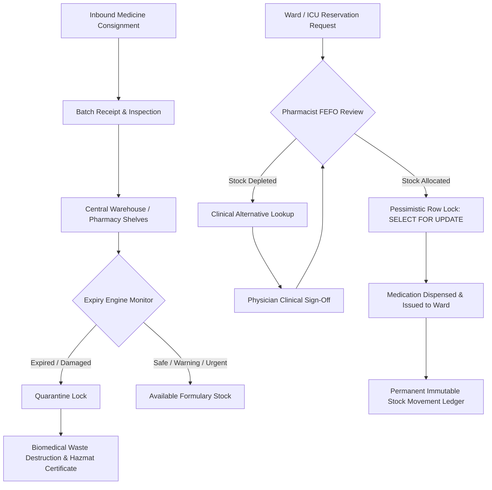

<div align="center">

# 🏥 MedWaste Watch
### *Smarter Medicine Management. Less Waste. Better Availability.*

[](https://php.net)
[](https://mysql.com)
[](https://developer.mozilla.org)
[](https://developer.mozilla.org)
[](backend/tests/run-tests.php)
[](https://who.int)

<p align="center">
  <b>A full-stack, enterprise-grade hospital medicine inventory management, expiry tracking, and clinical reservation web application.</b>
  <br>
  Built specifically for healthcare networks to eliminate medication stockouts, prevent expired batch dispensing, enforce strict <b>FEFO (First Expired, First Out)</b> allocation, and support physician-authorized bioequivalent substitutions.
</p>

[Quickstart](#-quickstart-guide) •
[Key Features](#-key-features) •
[Workflow Architecture](#-clinical-workflow-architecture) •
[Demo Accounts](#-clinical-demo-accounts) •
[API & Documentation](#-system-documentation)

---

</div>

## 🌟 Highlights at a Glance

| 🛡️ Zero Dispensing of Expired Stock | ⚡ Instant 1-Click Startup | 🌓 Dual Theme Dark / Light Mode |
|---|---|---|
| Automated quarantine boundary detection & strict shelf-life filtering | Pre-configured `start.bat` & `migrate.bat` scripts for seamless Windows execution | Hand-crafted clinical dark mode & daylight-optimized high-contrast light mode |

| 🧪 FEFO Batch Automation | 🔄 Clinical Bioequivalent Discovery | 🔒 Immutable Audit Trail |
|---|---|---|
| Auto-sorts lots by earliest expiry with pessimistic row locks | Identifies therapeutic alternatives when primary medicine is depleted | Complete tracking of all logins, stock moves, disposals, and approvals |

---

## 🎯 Key Features

### 1. 📦 Real-Time Database-Backed Formulary & Availability
- Separation of physical on-hand stock from reserve-locked quantities.
- Rigorous mathematical integrity:
  $$\text{Available to Reserve} = \text{Physical On-Hand} - \text{Quarantined} - \text{Expired} - \text{Active Reservations}$$
- Real-time stock status flags: `In Stock`, `Low Stock`, `Out of Stock`, `Quarantined`.

### 2. ⏳ 4-Tier Dynamic Expiry Priority Engine
The system dynamically categorizes physical consignments based on shelf-life remaining:
- <span style="color:#EF4444; font-weight:700;">🔴 Urgent ($\le 7$ days)</span>: Immediate dispatch alert for rapid clinical ward utilization.
- <span style="color:#F59E0B; font-weight:700;">🟡 Warning ($8 - 30$ days)</span>: Advisory window for high-priority rotation.
- <span style="color:#10B981; font-weight:700;">🟢 Safe ($> 30$ days)</span>: Optimal formulary stock.
- <span style="color:#64748B; font-weight:700;">⚪ Expired</span>: Automatic quarantine lock; strictly barred from patient reservation or dispensing.

### 3. 📋 Ward Stock Reservations & FEFO Allocation
- Ward nurses and ER staff request medications with urgency classification (`Routine`, `Urgent`, `STAT Emergency`).
- Central Pharmacy reviews requests and runs automated **First Expired, First Out (FEFO)** batch allocation using pessimistic MySQL row locks (`SELECT ... FOR UPDATE`) to prevent concurrent stock overallocation.
- Full cycle tracking: `Pending` ➔ `Approved & Allocated` ➔ `Issued / Dispensed` (or `Rejected` / `Cancelled`).

### 4. 💊 Clinical Alternatives & Physician Sign-Off
- When an essential drug is out of stock, the clinical recommendation engine scans therapeutic classes and active ingredients to suggest approved alternative medicines with live inventory.
- Attending physicians sign off with required clinical justifications prior to dispensing.

### 5. ☣️ Certified Biomedical Waste & Disposal
- Comprehensive logging for expired or damaged items across approved disposal methods:
  - High-temperature incineration
  - Chemical neutralization
  - Encapsulation / deep burial
  - Supplier batch recall return
- Tracks hazmat disposal agency certification references, destruction manifests, and financial loss metrics.

### 6. 🎨 Premium UI / UX & Responsive Design
- **Fixed Sidebar Navigation**: Fixed top logo header, fixed bottom user profile badge, and smooth scrollable balance navigation.
- **Glassmorphism Topbar**: Sticky header with dynamic breadcrumbs, live notification bell, and theme switch.
- **Micro-Interaction Toasts**: Smart 2.0s non-intrusive notification popups with duplicate suppression, instant close buttons, and automated theme toast replacement.
- **Zero Heavy Frameworks**: 100% vanilla ES6+ JavaScript modules and pure CSS design tokens — no React, Node.js, or build-step overhead.

---

## 🔄 Clinical Workflow Architecture



---

## 🚀 Quickstart Guide

### Prerequisites
- **Option A (Docker - Recommended)**: [Docker Desktop](https://www.docker.com/) installed and running.
- **Option B (Local Windows)**: **Windows OS** with **XAMPP** (or Apache + MySQL + PHP 8.2+).

---

### 🐳 Quickstart with Docker (1-Click Run)

Start the entire stack (PHP 8.2 Application + MySQL 8.0 + Automated Migrations & Seeds) in seconds:

```bash
docker compose up --build -d
```

Open **[http://localhost:8000](http://localhost:8000)** in your browser!

To stop containers:
```bash
docker compose down
```

To run clinical automated tests inside the container:
```bash
docker compose exec app php backend/tests/run-tests.php
```

---

### 💻 Local Windows Setup (Without Docker)

### 1️⃣ Database Configuration & Migration
Open [`backend/.env`](file:///C:/Users/Balamurugan/Desktop/MedWaste/backend/.env) and configure your local MySQL credentials:
```ini
DB_HOST=127.0.0.1
DB_PORT=3306
DB_DATABASE=medwaste_db
DB_USERNAME=root
DB_PASSWORD=your_mysql_password
```

Run the automated migration and seed script (creates schema, views, triggers, and demo data):
```powershell
.\migrate.bat
```
*Or directly via PHP:*
```powershell
& "C:\xampp\php\php.exe" backend/database/migrate.php
```

---

### 2️⃣ Verify Automated System Tests
Execute the 32-point automated test suite covering stock calculations, FEFO batch sorting, race condition isolation, and CSV formula injection security:
```powershell
.\test.bat
```
```text
========================================================
 MedWaste Watch — Automated System & Clinical Tests
========================================================
Tests Finished. Passed: 32, Failed: 0
```

---

### 3️⃣ Launch the Application
Start the built-in single-origin development server:
```powershell
.\start.bat
```
*Or run directly in PowerShell:*
```powershell
& "C:\xampp\php\php.exe" -S 127.0.0.1:8000 router.php
```
Open **[http://127.0.0.1:8000](http://127.0.0.1:8000)** in your browser!

---

## 👥 Clinical Demo Accounts

For instant testing, pre-configured demo credentials are provided for each hospital role:

| Role | Username | Password | Key Permissions & Dashboard Access |
|---|---|---|---|
| **Super Admin** | `admin` | `Password@123` | System settings, user accounts, audit trail, full access |
| **Central Pharmacist** | `pharmacist` | `Password@123` | Inbound batches, FEFO reservation approvals, issuing |
| **Emergency Nurse** | `nurse_er` | `Password@123` | ER medication requests, real-time formulary search |
| **ICU Physician** | `doctor_icu` | `Password@123` | Clinical substitutions & medical sign-off justification |
| **Compliance Auditor** | `auditor` | `Password@123` | Immutable audit trail, destruction compliance, CSV reports |

> [!TIP]
> On the [login screen](http://127.0.0.1:8000/login.html), you can click any of the **Quick Demo Fill** role chips to automatically populate credentials.

---

## 📂 Project Directory Structure

```text
MedWaste/
├── 📁 frontend/                         # Presentation Layer (Vanilla ES6+ & CSS3)
│   ├── index.html                       # Smart authentication redirector
│   ├── login.html                       # Clinical authentication portal
│   ├── dashboard.html                   # Executive KPI dashboard & visual charts
│   ├── medicines.html                   # Formulary catalog & drug registration
│   ├── medicine-details.html            # Medicine profile & batch analytics
│   ├── batches.html                     # Batch receipt & consignment tracking
│   ├── expiry.html                      # 4-tier FEFO expiry monitoring
│   ├── low-stock.html                   # Shortage alerts & reorder levels
│   ├── alternatives.html                # Bioequivalent medicine discovery
│   ├── reservations.html                # Ward requests & batch allocation
│   ├── transfers.html                   # Storage location transfers
│   ├── disposal.html                    # Biomedical waste & destruction log
│   ├── notifications.html               # Real-time alerts center
│   ├── reports.html                     # Financial reports & safe CSV exports
│   ├── users.html                       # Staff accounts & RBAC management
│   ├── departments.html                 # Hospital clinical units directory
│   ├── settings.html                    # System policies & threshold config
│   ├── audit-logs.html                  # Immutable security & change trail
│   ├── 📁 components/                   # Standalone HTML frame partials
│   │   ├── sidebar.html                 # Sidebar template
│   │   ├── navbar.html                  # Sticky topbar template
│   │   └── footer.html                  # Standardized footer template
│   └── 📁 assets/
│       ├── 📁 css/                      # Design tokens, typography, tables, dark theme
│       └── 📁 js/
│           ├── 📁 components/           # Modular sidebar.js, navbar.js, footer.js
│           ├── app.js                   # Application kernel & toast engine
│           ├── theme.js                 # Dark / Light theme switcher
│           ├── api.js                   # Authenticated Fetch wrapper
│           ├── auth.js                  # Session & token manager
│           └── navigation.js            # Unified layout frame coordinator
├── 📁 backend/                          # Backend REST API (Core PHP & PDO)
│   ├── 📁 app/
│   │   ├── 📁 Controllers/              # RESTful API route endpoints
│   │   ├── 📁 Services/                 # FEFO, Stock Math, Audit & Reports logic
│   │   ├── 📁 Middleware/               # Auth, CSRF, Rate Limiting, RBAC guards
│   │   └── 📁 Core/                     # Database PDO connection & Response helper
│   ├── 📁 database/                     # schema.sql, migrate.php, seed.php
│   ├── 📁 scripts/                      # Cron jobs: expiry-alerts & cleanup
│   └── 📁 tests/                        # 32-point automated test suite
├── 📁 docs/                             # Comprehensive System Architecture Docs
│   ├── architecture.md                  # System design & component breakdown
│   ├── database-design.md               # Complete ERD & schema dictionary
│   ├── api-documentation.md             # REST API routes & payload specs
│   ├── permissions-matrix.md            # Role-based access control rules
│   └── deployment.md                    # Production server hardening guide
├── start.bat                            # 1-Click launcher
├── migrate.bat                          # 1-Click database migration & seed
├── test.bat                             # 1-Click test suite runner
├── router.php                           # Single-origin PHP local router
└── README.md
```

---

## 🔒 Security & Regulatory Hardening

- **SQL Injection Prevention**: 100% prepared PDO statements with parameter binding; zero raw variable interpolations.
- **Cross-Site Scripting (XSS)**: Automatic output escaping (`App.escapeHtml`) throughout frontend UI templates.
- **CSRF Protection**: Synchronizer Token Pattern with per-session cryptographic tokens validated on all `POST`, `PUT`, `PATCH`, and `DELETE` requests.
- **Password Security**: Modern `PASSWORD_BCRYPT` hashing with work factor 12.
- **Brute Force Protection**: IP and user-based exponential backoff rate limiting.
- **CSV Formula Injection Mitigation**: Dynamic spreadsheet sanitization escaping dangerous prefixes (`=`, `+`, `-`, `@`, `\t`).
- **Pessimistic Concurrency**: MySQL row-level `FOR UPDATE` transaction locks to prevent double-booking of expiring batches.

---

## 📜 System Documentation

Detailed technical documents are available in the [`/docs`](file:///C:/Users/Balamurugan/Desktop/MedWaste/docs) directory:
- 📖 [**System Architecture & Tech Stack**](file:///C:/Users/Balamurugan/Desktop/MedWaste/docs/architecture.md)
- 🗄️ [**Database Design & Schema Dictionary**](file:///C:/Users/Balamurugan/Desktop/MedWaste/docs/database-design.md)
- 🔌 [**REST API Documentation**](file:///C:/Users/Balamurugan/Desktop/MedWaste/docs/api-documentation.md)
- 🛡️ [**Role Permissions Matrix (RBAC)**](file:///C:/Users/Balamurugan/Desktop/MedWaste/docs/permissions-matrix.md)
- 🚀 [**Production Deployment & Hardening**](file:///C:/Users/Balamurugan/Desktop/MedWaste/docs/deployment.md)

---

<div align="center">
  <sub>Hospital Clinical Health Record Standard • Compliant with NABH & WHO GMP Guidelines</sub><br>
  <b>MedWaste Watch Enterprise</b> &copy; 2026. All Rights Reserved.
</div>
